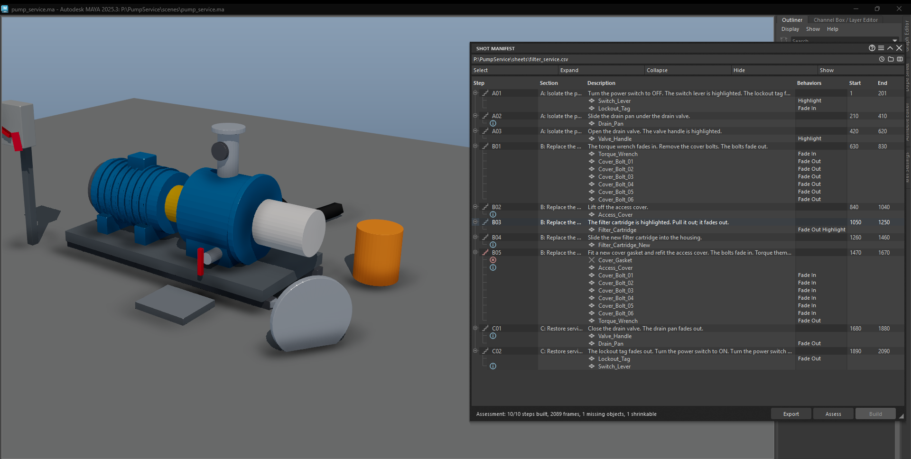

# Shot Manifest

A procedure's build sheet, turned into shots. Point the Shot Manifest at the
sheet the steps are written in (a CSV file or a Google Sheets link) and it
builds one shot per step: named after the step, holding its objects, with the
fades and highlights the sheet's text asks for already keyed. It keeps checking
from then on. When the sheet changes or the scene moves on, **Assess** shows
which steps are missing an object, a key or a shot, and **Build** brings the
scene back in line without touching an animator's keys.

The same panel ships in Maya (`mayatk`) and Blender (`blendertk`) over one
engine, pythontk's `ShotManifest`. The [Shot Sequencer](shot_sequencer.md)
edits the shots it builds, and the Scene Exporter carries each shot to the
engine as a [named animation clip](shot_export_unity.md).

*A ten-step filter service sheet, built: each step has its shot, its objects
and their fades and highlights, and Assess flags the one object the sheet
names that the scene does not have yet (B05's new gasket).*

**Contents:** [Getting started](#getting-started) · [The sheet](#the-sheet) ·
[Behaviors](#behaviors) · [Assess](#assess) · [Build](#build) · [When the
scene moves on](#when-the-scene-moves-on) · [Local Edits](#local-edits) ·
[Export](#export) · [Without a sheet](#without-a-sheet) · [What it
owns](#what-it-owns)

## Getting started

1. Browse to the sheet in the field at the top, or paste its web address and
   press Enter. The steps fill the table, each with its section, description,
   objects and behaviors. A sheet written in cells (the Linear and Interactive
   formats) is read with the template it is written for, whatever template you
   used last; what its own check finds wrong shows on its step at once, with
   the cell and the fix. (A new sheet: `python -m pythontk ops apply sheet.new
   out=<file.csv>` writes a template's starter to fill.)
2. In the header menu, check each behavior's mode. A behavior the sheet asks
   for by its word (`highlight`, `hide`) starts at **Key**; one a sentence
   only implies starts **Off** until you choose.
3. Click **Assess**. Each row's icon shows its worst issue; hover the row for
   the list.
4. Click **Build**. It is enabled once Assess finds something a build would
   change.

The panel's `?` button holds the short form of this page.

## The sheet

A sheet is written in the **Linear** or **Interactive** format: one table with
a row for each step itself (its ID, name and narration), then a row for each
thing that happens in it, a word in Action (`highlight`, `show`,
`hide`, `use` ...) and the objects it is about in Target. Every cell holds
one kind of thing and nothing is read from a sentence. The format is pythontk's
[build sheets](https://github.com/m3trik/pythontk/blob/main/docs/build_sheets.md)
guide, and each template ships a starter sheet to copy
(`python -m pythontk ops apply sheet.new out=<file.csv>`).

| Step | Step Name | Voice | Action | Target | With | Clip |
|:---|:---|:---|:---|:---|:---|:---|
| `B01` | Remove the filter | Remove the old filter with the wrench. | | | | |
| | | | `use` | `FILTER` | `WRENCH` | `B01_1` |
| | | | `hide` | `FILTER` | | |

The panel shows each row as the sentence its cells mean ("Selecting
LATCH_UPPER with KEY in hand plays A01_1"), keys the three words it builds
(`highlight`, `show` and `hide`) and leaves every other word alone, for the tool
that builds it. A look that names its take in Clip is keyed into that take. One
that names none belongs to its step: a Linear sheet, played straight through,
has it keyed into the step's shot; an Interactive one, whose steps wait on the
user, leaves it to the tool that runs the steps, and lists its object in the
shot with nothing keyed on it.
What is wrong with a row is said at its cell, with its fix: the step's row
reads *sheet issue* (its tooltip and the detail list each cell, as `row 2
(Clip): use needs its Clip: write the take it plays`), the footer counts them
as the sheet loads, the Build button counts the step among those that need
you, and Export's **Sheet Issues** column carries them to the sheet's owner.
No Build resolves one: its fix is the sheet's. A row such as `SECTION B:
Replace the filter` starts a section, as do `INTRO`, `OUTRO` and `QUIZ` rows.

### A sheet of sentences

A sheet written before the format (the screenshot's) is still read, by its
sentences: a header row names the columns, then one row per step, and a row
with no step ID adds objects to the step above, each row with its own
description. The tolerant `default` template reads:

| Column | Headers it accepts | Holds |
|:---|:---|:---|
| Step | Step, ID, Number | The step ID: `A01.)`, or `A01`, `IN_01`, `B03.5` |
| Description | Description, Step Contents, Contents, Details | What happens; the behaviors are read from it |
| Assets | Assets, Asset Names, Asset, Objects | The step's objects, one per line |
| Voice | Audio, Voice, Voice Support, VO | Narration (optional) |
| Behaviors | Behaviors, Behavior | Behavior names, when the template reads them from a column (optional) |

| Step | Description | Assets |
|:---|:---|:---|
| `SECTION B: Replace the filter` | | |
| `B01.)` | The torque wrench fades in. | `Torque_Wrench` |
| | Remove the cover bolts. The bolts fade out. | `Cover_Bolt_01` ... `Cover_Bolt_06` |
| `B02.)` | Lift off the access cover. | `Access_Cover` |
| `B03.)` | The filter cartridge is highlighted. Pull it out; it fades out. | `Filter_Cartridge` |

### The template and its options

The columns button on the field picks the mapping template and sets its
options for the loaded sheet:

- **Step IDs**: Auto reads `A01.)` sheets and `A01` / `IN_01` sheets alike.
- **Behaviors**: read from the description, the Behaviors column, or the
  column where a row fills it and the description elsewhere.
- **Objects**: the Assets column, or else what the description names by a
  behavior ("Highlight Red Door" lists `Red_Door`).
- **Match Shots**: by name, or by name and then timeline order, for a scene
  whose shots were named before the sheet existed.
- **Shots**: every step gets a shot, or only a step one of whose rows names
  an animation clip (the Animation Clip Names column). A shot is its step:
  named by the step's ID, holding its narration and its takes. A take (a clip
  cell) is a span inside its step's shot, what one row plays and one clip of
  an export, so a step with two takes is one shot holding two takes and none
  is split by hand. In a scene whose takes were cut by hand as shots of their
  own before the sheet said so, Build joins a step's take shots into the
  step's shot, each take keeping its frames (shots another shot stands
  between, or a locked one, are left as they are, and it says so). A step
  with no shot
  shows *no shot* in its Start cell; Build makes none and places nothing for
  it. Right-click a step to **Mark as No Shot** or **Mark as a Shot**: a Local
  Edit, drawn as a redline on the Start cell with the sheet's word in its
  tooltip. A step that already has a shot keeps it.
- **Audio**: the voice column as narration only, a clip name derived per
  step and keyed, or each step's recording, else the narration rendered for
  its line (`narration.render`), keyed at its shot's start, its track in the
  Shot Sequencer. A step that only speaks is as long as its line. A shot
  shorter than its line grows to hold it, as an edge drag in the Shot
  Sequencer does: the shots after it move with their animation and audio, and
  a take inside it stays on its keys.
- **Auto-fill Missing Assets**: a step the sheet lists no objects for takes
  its shot's members, ready for Export to hand back to the sheet's owner.

A template of your own goes in the folder the picker's **Open Folder**
opens; the panel writes the format's reference, `MAPPING_FORMAT.md`, there.

## Behaviors

| Behavior | The sheet says | Build keys |
|:---|:---|:---|
| Visibility · show | "... fades in" | The object fading in at the shot's start |
| Visibility · hide | "... fades out", "fades away" | The object fading out at the shot's end |
| Highlight | "... is highlighted", "Highlight ..." | A highlight pulsing across the shot |
| Set Clip | A clip name (the template's Audio option) | The step's audio clip, from the shot's start |

The scene's effect recipe, kept in Render Effects, sets the fade lengths and
the highlight's cadence and colours. Visibility is one behavior set two ways, its
chips saying which (*Visibility · show*, *Visibility · hide*); a template joins a behavior
the same way (its `family` and `variant`). Each behavior has a mode in the
header menu, one for both ways of Visibility:

- **Key**: Build keys it.
- **Marker**: Build keys nothing and puts a marker on the Shot Sequencer's
  timeline where the keys would go, naming the objects, for keying by hand.
  Assess checks the marker is there.
- **Off**: neither keyed nor marked, and not reported by Assess.

The modes are kept with the scene, for its sheet: whoever builds the scene
builds the same. A scene that keeps none starts each behavior its sheet asks
for by its word at Key (a row in cells is an explicit ask, built where the
sheet is read first), and the clips its Audio option gives its steps with
them; your own Marker choice wins over that, and every other behavior is at
your own choice, Off until you make one. The rule is pythontk's
(`ManifestEdits.modes_in_force`), so a build from code (`ShotManifest.sync`)
starts from the same modes as the panel's Build, and records them with the scene.

### Helpers a row names

A row of a word that places something (`travel`, `indicate`, `picture`) can name
the object it happens at in its Settings: `where=VIEW_FRONT`, `where=CAM_B02`.
Where the scene has no object of that name, Build makes it: a camera for a
picture, a locator for a viewpoint or a pointer's tip, under the part it is for
(a viewpoint under the delivery's root), at a first pose found as the scene
stands at the step's shot: on the floor where its eyes see the part, a
picture where the part is seen whole (never behind the panel it sits on),
a pointer's tip beside the part in free space and never end-on. It is the one
placement every tool uses, so Unity makes its own helpers by the same rules. It is there to be moved: frame the
camera, stand the viewpoint where the user should be. Build never moves an
object that exists, so a second Build leaves your framing as it is, and the
export carries it to the tool that runs the steps, which uses it exactly as
it stands. A row that names none gets its own, named from what it says (`CAM_B02_DOOR_GRP`: its kind, step and target), which the tool that runs the steps finds by the same name. A word turned Off places nothing.

### States a row names

A `set` row (`set | LED | state=amber`) switches an indicator's light by name
as its step starts. Build makes sure the indicator has that state: the
emissive group it wears (Emissive Groups) takes the tool's default states
where it has none (off, green, blue, amber, red; off and on where its
emission is a map), and keeps its own where it has them. The export carries
them, and the tool that runs the steps switches by the same names. Build keys
nothing for the row. An indicator that wears no emissive group is said, and
left to that tool, which gives a plain emissive material the same default
states itself.

## Assess

Assess compares the manifest with the scene and writes nothing. A step row's
icon is its state, a shape for each in that state's colour: a check when the
row is in order, a note where Build has work for it (not built, to update), a
warning triangle, an error cross (such as an object missing from the scene), a
pencil for a shot edited by hand, a padlock for a locked one. A step not
assessed yet has no icon. The **Status**
column beside the step says that issue in a few words ("2 not in scene", "not
built", "keys missing"), and the row's tooltip lists every issue. While the
results show, they stay current: an edit, the sheet read again, a hide or a
shot edited anywhere runs Assess again.

The **Build** button counts the steps a build would change, "Build (3)", and
its tooltip says the plan: how many shots it creates and updates, how many it
keeps as a hand left them, how many are locked, and how many wait on a person
(an object no build can supply).

Above the table:

- **Select**: rows (with issues, unbuilt, all, none), or the rows' objects in
  the scene.
- **Expand** / **Collapse**: every row, the rows with or without issues, those
  holding objects the sheet does not list, or the selected rows.
- **Hide** / **Show**: the selected steps or their sections, and the steps
  without a shot. **Steps With Nothing to Do** leaves only the rows that need
  something (an issue, a build to do, a Local Edit, a shot the sheet lacks); it
  is a view alone, so Assess and Build still take every step.
- **Search**, at the row's right end (as the Unity manifest's): only the steps
  whose words match every word typed show (a step's ID, name and status, its
  objects' names and behaviors); a view alone, too.

Under the table, the selected row's detail: its words, its behaviors' states
and every issue its tooltips list (drag the splitter to fold it away).

Each object's behaviors are chips in the Behaviors cell, as in the Unity
manifest: each in its state's colour and led by its glyph (a note to build
or to re-key, a warning, an error, a pencil where a Local Edit added it;
built ones plain), a type set to Marker led by ◆, and one off or taken away
here struck through. A behavior a sentence only implies is Off until you set
it, so its chips start struck: click one and pick Key or Marker for Every Row
(or set each type in the header menu's Behaviors). Each has its own tooltip and
menu (on or off for that object while its type is keyed or marked, its Key /
Marker / Off for every row, the page that edits it), and a
+ gives the object a behavior its kind offers that it lacks. The Key /
Marker / Off choices are kept with the scene, for its sheet (see
[Behaviors](#behaviors)).

What a Build keys rides the delivery: each object's behavior in a shot's
record says how it was made (`mode`: key or marker), and a Unity manifest
built from the same sheet leaves the keyed ones to the delivery (*in the
delivery*), building the rest. Used alone, each manifest builds all it can.

Right-click a step to open its shot in the Shot Sequencer, or an object row to
show it in the Outliner, apply its behaviors, or open Render Effects on that
object alone.

## Build

The first Build lays the shots out in sheet order, each at the length the
Shots settings give, with the gap between them. Type a frame into a step's
**Start** or **End** first to place it yourself (double-click the cell); later
steps re-flow. Solid text is a shot's own frame or one you typed; dim italic
is where Build would place a new shot.

Later Builds update what changed:

- A step with no shot yet gets one in sheet order, after its previous step's
  shot. The shots after it move later with their keys, once you confirm how
  many. Until then Start / End show only frames that hold now: a shot's own
  (its keys are there; its tooltip says where Build moves it), and a new
  shot's where Build places it without moving another. A new shot that needs
  room made shows *insert*; its tooltip says where it lands and how far the
  shots after it move.
- Behaviors an older effect recipe keyed are keyed again, and the keys of
  behaviors the sheet dropped are removed.
- A shot's name, description and members follow the step.

Build never changes a locked shot, nor a shot edited by hand since its last
Build (renamed, resized, its members or description changed) unless **Edits**
in the header menu is set to **Rebuild Hand-Edited Shots**. It never creates,
renames or removes a scene object, and never removes a shot.

A step row leads its right-click menu with its own fix, in bold, for that row
(or the selection's rows of its kind) alone: **Build** where a Build would
change its built shot, **Rebuild from Sheet** where a hand edited it. Either
way the shot gets the sheet's name, description, objects and behaviors, keeps
its range, and no other row is built. One undo step; a locked shot stays, and
a step with no shot yet is the Build button's to place.

## When the scene moves on

Every shot lists its members; a step's shot also shows the members the step
does not list, with no Assess needed. What moves inside an object the step
lists (a group's own node, a part of it) is that object, never *not listed*.

A shot no step pairs with, split off or added in the Shot Sequencer, shows as a
*not in doc* row where the timeline has it. Right-click it to open it, reveal
its members, **Add to the Manifest** (a step of its own), **Pair with Step**
(the shot of a step that has none) or **Remove Shot**, which leaves its keys in
the scene.

**Lock** a step, a selection or a whole section (right-click) when it is
final: Build never changes its shot, and its row takes no edits until you
unlock it.

## Local Edits

Revise the manifest without touching the sheet. Double-click a step's name or
description, or an object's name, to edit it; right-click to add a step, hide
steps, move an object to another step, rename every row of one object, or
revert. Edits are kept with the scene and always applied, and Build follows
them. Edited cells read as redlines, italic and amber, and their tooltip shows
the sheet's value.

- Renaming a built step renames its shot on the next Build, and the clip it
  exports as. Renaming an object only changes which scene object the step
  means; the object itself is never renamed.
- **Edits** (header menu): **Keep All Edits**, **Rebuild Hand-Edited Shots**,
  or **Compare to Original Sheet**, a read-only view of the sheet as delivered.
  **Reset** beside it drops every edit.

## Export

**Export** previews the manifest as CSV, JSON or Markdown: the rows the table
shows or the selected ones, with Local Edits, frames and status included. Set
the format, rows, object layout and columns and the preview follows; then
**Copy** it or **Save As** a file. It never writes the loaded sheet.

## Without a sheet

Leave the field empty and the table shows the scene's own shots with their
descriptions; Assess checks them for missing objects and behaviors. A scene
with no shots yet gets them detected from its animation, using the Shots
settings; refine the ranges, then Build. A scene built from a sheet reopens
checked against that sheet.

## What it owns

These are the rules any change to the Shot Manifest keeps. Ownership decides
every feature: the sheet owns the plan, the manifest owns what it generates
(shots, their membership, its own behavior keys, which the shot ledger records
as authored), and artists own the scene's content and their keys. Before
adding a feature, ask which side of that line it writes.

- **It never creates, renames or deletes scene objects.** A missing object is
  a finding for an artist, never a placeholder. An object's name in the table
  says which scene object a step means; editing it never renames the object.
- **The panel's Build never removes a shot.** tentacle's Shot Manifest panel
  builds with `remove_missing=False`, so a shot no step pairs with is listed
  and removed by hand, one at a time. That is the panel's choice, not the
  engine's: `ShotManifest.sync` and `update` default to `remove_missing=True`
  and remove such a shot for a caller that keeps the default.
- **It never keys over an animator's keys**, and never guesses which step goes
  with which stretch of time on an unbuilt scene: steps pair through
  `ShotManifest.pair`, and placing steps onto animated regions by order is
  asked first.
- **The sheet is never written.** The user's edits (names, descriptions,
  objects, behaviors, hidden, moved and added steps) are an overlay,
  `ptk.ManifestEdits`, keyed by the sheet's own IDs and saved with the scene;
  they always apply. A step's ID stays its shot binding, so renaming a step
  renames its shot. A locked step takes no edits and Build passes it by.
  Comparing to the original sheet is a read-only view, never saved.
- **Reconcile both ways, with explicit verbs**: Build (manifest to scene), Add
  to the Manifest and Pair with Step (scene to manifest), Export (the manifest
  out, to a file or the clipboard, never into the loaded sheet).
- **A showing assessment stays current by itself.** An edit, a sheet read
  again, a hide toggle or a shot edit re-runs it (debounced), so no path leaves
  stale results up or needs another Assess.
