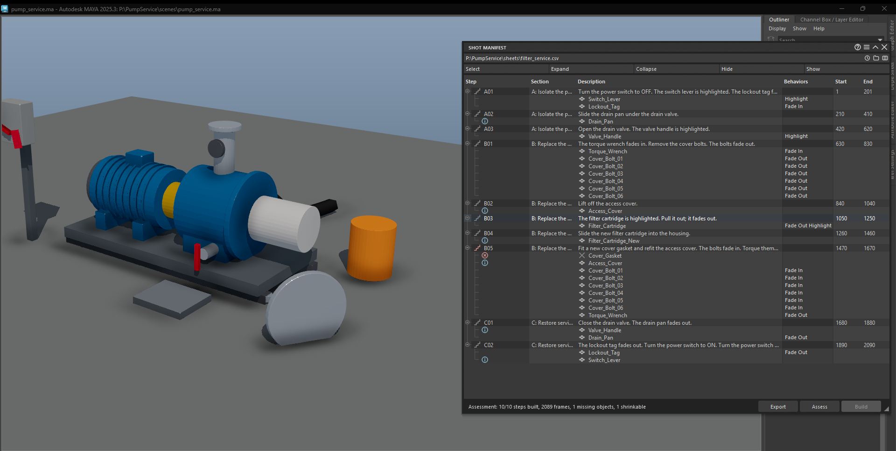

# Shot Manifest

A procedure's build sheet, turned into shots. Point the Shot Manifest at the
sheet the steps are written in (a CSV file or a Google Sheets link) and it
builds one shot per step: named after the step, holding its objects, with the
fades and highlights the sheet's text asks for already keyed. It keeps checking
from then on. When the sheet changes or the scene moves on, **Assess** shows
which steps are missing an object, a key or a shot, and **Build** brings the
scene back in line without touching an animator's keys.

The same panel ships in Maya (`mayatk`) and Blender (`blendertk`) over one
engine, pythontk's `ShotManifest`. The [Shot Sequencer](shot_sequencer.md)
edits the shots it builds, and the Scene Exporter carries each shot to the
engine as a [named animation clip](shot_export_unity.md).

*A ten-step filter service sheet, built: each step has its shot, its objects
and their fades and highlights, and Assess flags the one object the sheet
names that the scene does not have yet (B05's new gasket).*

**Contents:** [Getting started](#getting-started) · [The sheet](#the-sheet) ·
[Behaviors](#behaviors) · [Assess](#assess) · [Build](#build) · [When the
scene moves on](#when-the-scene-moves-on) · [Local Edits](#local-edits) ·
[Export](#export) · [Without a sheet](#without-a-sheet) · [What it
owns](#what-it-owns)

## Getting started

1. Browse to the sheet in the field at the top, or paste its web address and
   press Enter. The steps fill the table, each with its section, description,
   objects and behaviors.
2. In the header menu, set each behavior type you want keyed to **Key**. Every
   type starts **Off**.
3. Click **Assess**. Each row's icon shows its worst issue; hover the row for
   the list.
4. Click **Build**. It is enabled once Assess finds something a build would
   change.

The panel's `?` button holds the short form of this page.

## The sheet

A header row names the columns, then one row per step. A row with no step ID
adds objects to the step above, each row with its own description. The
built-in template reads:

| Column | Headers it accepts | Holds |
|:---|:---|:---|
| Step | Step, ID, Number | The step ID: `A01.)`, or `A01`, `IN_01`, `B03.5` |
| Description | Description, Step Contents, Contents, Details | What happens; the behaviors are read from it |
| Assets | Assets, Asset Names, Asset, Objects | The step's objects, one per line |
| Voice | Audio, Voice, Voice Support, VO | Narration (optional) |
| Behaviors | Behaviors, Behavior | Behavior names, when the template reads them from a column (optional) |

A row such as `SECTION B: Replace the filter` starts a section; with numbered
IDs, `INTRO` and `OUTRO` rows do too. The rows behind the screenshot read:

| Step | Description | Assets |
|:---|:---|:---|
| `SECTION B: Replace the filter` | | |
| `B01.)` | The torque wrench fades in. | `Torque_Wrench` |
| | Remove the cover bolts. The bolts fade out. | `Cover_Bolt_01` ... `Cover_Bolt_06` |
| `B02.)` | Lift off the access cover. | `Access_Cover` |
| `B03.)` | The filter cartridge is highlighted. Pull it out; it fades out. | `Filter_Cartridge` |

The columns button on the field picks the mapping template and sets its
options for the loaded sheet:

- **Step IDs**: Auto reads `A01.)` sheets and `A01` / `IN_01` sheets alike.
- **Behaviors**: read from the description, the Behaviors column, or the
  column where a row fills it and the description elsewhere.
- **Objects**: the Assets column, or else what the description names by a
  behavior ("Highlight Red Door" lists `Red_Door`).
- **Match Shots**: by name, or by name and then timeline order, for a scene
  whose shots were named before the sheet existed.
- **Audio**: the voice column as narration only, or a clip name derived per
  step and keyed.
- **Auto-fill Missing Assets**: a step the sheet lists no objects for takes
  its shot's members, ready for Export to hand back to the sheet's owner.

A template of your own goes in the folder the picker's **Open Folder**
opens; the panel writes the format's reference, `MAPPING_FORMAT.md`, there.

## Behaviors

| Behavior | The sheet says | Build keys |
|:---|:---|:---|
| Fade In | "... fades in" | The object fading in at the shot's start |
| Fade Out | "... fades out", "fades away" | The object fading out at the shot's end |
| Highlight | "... is highlighted", "Highlight ..." | A highlight pulsing across the shot |
| Set Clip | A clip name (the template's Audio option) | The step's audio clip, from the shot's start |

The scene's effect recipe, kept in Render Effects, sets the fade lengths and
the highlight's cadence and colours. Each type has a mode in the header menu:

- **Key**: Build keys it.
- **Marker**: Build keys nothing and puts a marker on the Shot Sequencer's
  timeline where the keys would go, naming the objects, for keying by hand.
  Assess checks the marker is there.
- **Off**: neither keyed nor marked, and not reported by Assess.

The modes are kept per user, for every scene.

## Assess

Assess compares the manifest with the scene and writes nothing. A row's icon
takes the colour of its worst issue: ✖ error (such as an object missing from
the scene), ▲ warning, ● note, ■ locked or edited. The row's tooltip lists
every issue. While the results show, they stay current: an edit, the sheet
read again, a hide or a shot edited anywhere runs Assess again.

Above the table:

- **Select**: rows (with issues, unbuilt, all, none), or the rows' objects in
  the scene.
- **Expand** / **Collapse**: every row, the rows with or without issues, those
  holding objects the sheet does not list, or the selected rows.
- **Hide** / **Show**: the selected steps or their sections, and the steps
  without a shot.

Right-click a step to open its shot in the Shot Sequencer, or an object row to
show it in the Outliner, apply its behaviors, or open Render Effects on that
object alone.

## Build

The first Build lays the shots out in sheet order, each at the length the
Shots settings give, with the gap between them. Type a frame into a step's
**Start** or **End** first to place it yourself (double-click the cell); later
steps re-flow. Solid text is a frame you typed; dim italic is filled in.

Later Builds update what changed:

- A step with no shot yet gets one in sheet order, after its previous step's
  shot. The shots after it move later with their keys, once you confirm how
  many.
- Behaviors an older effect recipe keyed are keyed again, and the keys of
  behaviors the sheet dropped are removed.
- A shot's name, description and members follow the step.

Build never changes a locked shot, nor a shot edited by hand since its last
Build (renamed, resized, its members or description changed) unless **Edits**
in the header menu is set to **Rebuild Hand-Edited Shots**. It never creates,
renames or removes a scene object, and never removes a shot.

## When the scene moves on

Every shot lists its members; a step's shot also shows the members the step
does not list, with no Assess needed.

A shot no step pairs with, split off or added in the Shot Sequencer, shows as a
*not in doc* row where the timeline has it. Right-click it to open it, reveal
its members, **Add to the Manifest** (a step of its own), **Pair with Step**
(the shot of a step that has none) or **Remove Shot**, which leaves its keys in
the scene.

**Lock** a step, a selection or a whole section (right-click) when it is
final: Build never changes its shot, and its row takes no edits until you
unlock it.

## Local Edits

Revise the manifest without touching the sheet. Double-click a step's name or
description, or an object's name, to edit it; right-click to add a step, hide
steps, move an object to another step, rename every row of one object, or
revert. Edits are kept with the scene and always applied, and Build follows
them. Edited cells are italic, and their tooltip shows the sheet's value.

- Renaming a built step renames its shot on the next Build, and the clip it
  exports as. Renaming an object only changes which scene object the step
  means; the object itself is never renamed.
- **Edits** (header menu): **Keep All Edits**, **Rebuild Hand-Edited Shots**,
  or **Compare to Original Sheet**, a read-only view of the sheet as delivered.
  **Reset** beside it drops every edit.

## Export

**Export** previews the manifest as CSV, JSON or Markdown: the rows the table
shows or the selected ones, with Local Edits, frames and status included. Set
the format, rows, object layout and columns and the preview follows; then
**Copy** it or **Save As** a file. It never writes the loaded sheet.

## Without a sheet

Leave the field empty and the table shows the scene's own shots with their
descriptions; Assess checks them for missing objects and behaviors. A scene
with no shots yet gets them detected from its animation, using the Shots
settings; refine the ranges, then Build. A scene built from a sheet reopens
checked against that sheet.

## What it owns

These are the rules any change to the Shot Manifest keeps. Ownership decides
every feature: the sheet owns the plan, the manifest owns what it generates
(shots, their membership, its own behavior keys, which the shot ledger records
as authored), and artists own the scene's content and their keys. Before
adding a feature, ask which side of that line it writes.

- **It never creates, renames or deletes scene objects.** A missing object is
  a finding for an artist, never a placeholder. An object's name in the table
  says which scene object a step means; editing it never renames the object.
- **The panel's Build never removes a shot.** tentacle's Shot Manifest panel
  builds with `remove_missing=False`, so a shot no step pairs with is listed
  and removed by hand, one at a time. That is the panel's choice, not the
  engine's: `ShotManifest.sync` and `update` default to `remove_missing=True`
  and remove such a shot for a caller that keeps the default.
- **It never keys over an animator's keys**, and never guesses which step goes
  with which stretch of time on an unbuilt scene: steps pair through
  `ShotManifest.pair`, and placing steps onto animated regions by order is
  asked first.
- **The sheet is never written.** The user's edits (names, descriptions,
  objects, behaviors, hidden, moved and added steps) are an overlay,
  `ptk.ManifestEdits`, keyed by the sheet's own IDs and saved with the scene;
  they always apply. A step's ID stays its shot binding, so renaming a step
  renames its shot. A locked step takes no edits and Build passes it by.
  Comparing to the original sheet is a read-only view, never saved.
- **Reconcile both ways, with explicit verbs**: Build (manifest to scene), Add
  to the Manifest and Pair with Step (scene to manifest), Export (the manifest
  out, to a file or the clipboard, never into the loaded sheet).
- **A showing assessment stays current by itself.** An edit, a sheet read
  again, a hide toggle or a shot edit re-runs it (debounced), so no path leaves
  stale results up or needs another Assess.
